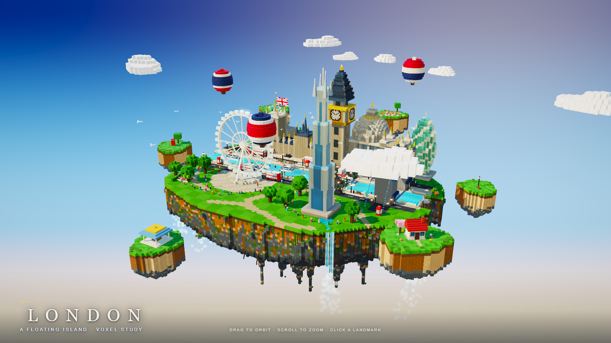

# LONDON — A Floating Island (voxel diorama)

**▶ 在线试玩:** https://hinaayanami.github.io/london-voxel-diorama/



单文件 HTML，Three.js 体素版「天空中的伦敦浮岛」。双击即可打开，**完全离线**（Three.js r160 已内联，无任何外链请求）。

## 打开

```
london_voxel_diorama.html
```

浏览器需要支持 WebGL2（Chrome / Edge / Firefox 均可）。首次打开会在本地实时生成约 6.5 万个方块，约 1–2 秒。

## 画面内容

- **浮岛**：不规则椭圆，波浪海岸线，分层岩壁（橙/褐/灰岩层 + 苔藓、悬根、垂藤小花），下方是收窄的锯齿岩体与石笋尖刺，另有 16 组附着巨石。
- **泰晤士河**：横贯全岛，浅水渠，自两端倾泻成 46 单位高的大瀑布（带雾气粒子）；另有 3 条公园小溪从岛缘落下。
- **地标**：威斯敏斯特宫 + 维多利亚塔（挥动的英国国旗）+ 大本钟（4 面走针钟面）、伦敦眼（32 个玻璃舱随轮转动并保持水平）、塔桥（双塔、蓝色高空连廊、可升起的活动桥面、悬链）、碎片大厦、小黄瓜、圣保罗大教堂、伦敦塔、白金汉宫 + 维多利亚纪念堂（红色花环）+ 卫兵换岗行进、特拉法加广场（纳尔逊纪念柱、四狮、两座喷泉、国家美术馆）、威斯敏斯特桥。
- **生活**：约 300 个行走小人、16 辆红色双层巴士/黑色出租车沿两条滨河环路行驶、6 艘游船、20 只海鸥、3 只英国国旗热气球、7 团体素云、6 座小浮岛（电话亭 / 路灯 / 红色屋顶小屋 / 池塘与迷你瀑布 / 花圃 / 凉亭）。
- **光照**：暖色低角度太阳 + 长投影（4096 阴影贴图）、半球光、冷暖补光、逐体素烘焙接触遮蔽、ACES 色调映射、轻 bloom、4× MSAA、屏幕空间天空渐变。

## 交互

- **拖动**（鼠标左键 / 触屏）：左右改变环绕角度，上下改变俯仰（约 5°–49°），松开即停。
- **滚轮**：缩放 0.55×–1.85×（滚轮上推放大）。
- **点击地标**：相机平滑飞到该建筑（自动按包围盒取景，约 1 秒），屏幕中央偏右浮出一组无边框文字：`LANDMARK 0X` / 英文名 / 中文名 / 两行介绍；锚点上有金色标记点，并用一条金色细引线连到文字。进入特写时底部提示条会换成「拖动旋转 · 滚轮缩放 · 点空白或 ESC 返回」。文字按行依次升起淡入（每行错开 0.13 秒），不是整块弹出。
- **在特写里**：拖动 = 绕该建筑旋转，滚轮 = 继续推近/拉远（0.45×–2.2×）；点击空白处或 ESC 返回全景。
- **文字自适应**：没有底板。标签出现后每 0.2 秒从帧缓冲里采样文字背后的实际像素亮度，背景亮就转成深墨色（配白色柔光），背景暗就转成浅色（配深色柔光），颜色切换有 0.45 秒过渡，不打断画面。
- **静置 3 秒**后，相机会以你当前的环绕角度和缩放为基准，重新开始 12 秒自动摆动——不会跳回初始机位。
- 底部提示条出现 10 秒后自动淡出；鼠标悬停时光标为抓手，悬停在地标上变为指针。

可点击的地标共 11 处：大本钟、威斯敏斯特宫、伦敦眼、塔桥、碎片大厦、小黄瓜、圣保罗大教堂、伦敦塔、白金汉宫、特拉法加广场、威斯敏斯特桥。

## 动画

- 相机：默认 12 秒一个完整周期，绕岛约 50°（往复摆动，首尾无缝），极轻微推近，仰角轻微起伏，全岛始终入镜（每帧按包围点自动计算距离）。拖动/缩放会立即接管，静置后在同一视角、同一缩放上恢复摆动。
- 塔桥活动桥面：12 秒升—停—降—停循环。
- 伦敦眼：52 秒一圈，玻璃舱反向补偿保持竖直。
- 大本钟：四面对称走针（24 倍速，便于看清）。
- 其他：瀑布水流/雾气、河水波纹、旗帜飘动、卫兵行进、行人与车辆、游船、海鸥、热气球、云、浮岛起伏全部持续动画。

> 说明：相机与环境循环严格 12 秒；伦敦眼与大本钟为连续运转（不强行卡在 12 秒上），因此循环播放时不会出现跳帧。

## 调试参数

- `?t=6` — 冻结在某一时刻（0–12 秒），用于截图/审片。
- `window.__diag` — 渲染探针（体素数、帧数、fps、错误）。
- `window.__setTime(3.5)` — 运行时跳到指定时间。

## 技术要点

- 静态世界：所有方块按材质合并为 4 个 `InstancedMesh`（solid / glass / metal / glow），总共约 6.5 万实例，1 个 draw call / 材质；逐实例颜色差分出草地、石层、树叶等。
- 逐体素 AO：用占用哈希表判断上方/斜上方邻居，生成接触阴影（比后处理 SSAO 便宜且更贴合体素）。
- 动态物件：公交、游船、气球、卫兵等用自写的 box-merge 生成单个 BufferGeometry，克隆共享。
- 后处理：HDR 半浮点 RT（4× MSAA）→ 亮度提取 → 两级模糊 → 合成（ACES + 饱和度 + 暗角 + sRGB）。
- 相机取景：对视锥内每个关键点解析求解所需距离，保证任何轨道角度下整岛（含浮岛、瀑布尾、热气球）都在画面内；用户缩放是在这个自适应距离上乘系数，所以拉远拉近都不会穿模。
- 交互：Pointer Events + `pointercapture` 实现拖拽（触屏同样可用），滚轮缩放带指数平滑；自动摆动权重在 3 秒静置后从 0 渐入，避免接管瞬间的位置跳变。

## 文件

```
index.html                    交付文件（单文件，~780 KB）
screenshots/                  预览帧（t=0/4/8）
tools/                       构建脚本与源码分片（src/*.js → build.js 拼装）
  ├─ three.min.js             内联用 Three.js r160
  ├─ template.html            HTML/CSS 外壳
  └─ src/01_core …05_animate  生成逻辑
```

修改源码后运行 `node tools/build.js` 重新拼装即可。

## 许可

本项目代码以 MIT 许可发布，见 [LICENSE](LICENSE)。内联的 three.js r160 为 MIT，
其声明见 [THIRD-PARTY-NOTICES.md](THIRD-PARTY-NOTICES.md)。
